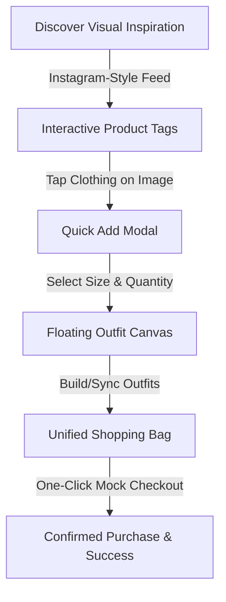

# FITHAUS — Gen Z Fashion Shopping App

FITHAUS is a premium social commerce platform that synthesizes the visual inspiration of social media feeds with the utility of modern e-commerce checkout. Inspired by the concept of "Instagram for Shopping," FITHAUS allows users to discover, compile, and buy street fashion directly from the visual feeds of their favorite brands and creators.

> [!NOTE]
> This project is built as a complete interactive frontend implementation modeled from the design parameters specified in the [Figma Design Template](https://www.figma.com/design/iqv9Er1TVY5ksJFQlNG7Qf/Gen-Z-Fashion-Shopping-App).

> [!IMPORTANT]
> Currently, this application is a **frontend prototype** showcasing the interactive user experience, dynamic client-side state logic, responsive styling, and animations. No live backend database, user auth, or payment gateway APIs are connected.

---

## 💡 The Core Concept: Combining Social & Shopping

Traditional e-commerce platforms focus on search and grid-based catalogs, which can feel transactional. Social platforms like Instagram are where users go for outfit inspiration, but the purchase flow is fragmented (requiring bio link clicking, third-party browsers, and manual searches).

**FITHAUS bridges this gap by merging both ecosystems:**



### 1. Instagram-Style Feed Integration
- **Interactive Visual Scroll**: Browse real-time photos uploaded by verified brands and creators in an infinite-scroll layout.
- **Tagged Items**: Each post contains custom shopping tag indicators (`ShoppingBag`) overlaid directly onto the clothing items. Tapping a tag opens product card overlays displaying prices, sizes, and brand credentials.
- **Brand vs. Creator Mode**: Toggle modes instantly (`B` for Brands, `C` for Creators) to filter between official collections and user-generated styling lookbooks.

### 2. Interactive Fitting Tool: "Build Your Fit"
- **Floating Outfit Canvas**: Compile entire outfits on a visual workspace tray pinned at the bottom.
- **Dynamic Category Filtering**: Group catalog selections (Tops, Bottoms, Footwear) using a drop-down filter header.
- **Dynamic Valuation**: Displays total outfit price configurations in real-time.
- **Direct Cart Adding**: Transfer the entire custom look to the global shopping bag with a single tap.

### 3. Full-Detail Pages & Dynamic Resolvers
- Clicking **"View Full Details"** navigates to a complete details route `/product/:productId`.
- The product detail page features multi-image carousels, expandable material/fit descriptions, stock indicators, and direct size selection.
- Features a **dynamic fallback generator** that resolves details from location state, local store lists, or alphanumeric configurations to ensure zero broken paths.

---

## 🛠️ Technology Stack & Architecture

- **Core Framework**: React 18 & Vite (TypeScript-enabled)
- **Styling**: Tailwind CSS v4 & custom HSL colors
- **Motion & Transitions**: Framer Motion (spring physics, tap feedback, success confetti particles)
- **Routing**: React Router v7 (clean params routing for `/brand/:brandId`, `/creator/:creatorId`, and `/product/:productId`)
- **Icons**: Lucide React
- **Data Persistence**: Unified local-storage hook tracking cart counters across all navigations.

---

## 🚀 Getting Started

### Prerequisites
Make sure you have [Node.js](https://nodejs.org/) installed (v18 or higher recommended).

### Installation
1. Clone the repository and navigate to the project directory:
   ```bash
   cd "Gen Z Fashion Shopping App"
   ```
2. Install dependencies:
   ```bash
   npm install
   ```

### Running Locally
To launch the Vite development server:
```bash
npm run dev
```

The terminal will launch and output your server paths:
* **Local Access Link**: `http://localhost:5173/`
* **Exposed Network Link**: `http://<your-local-ip>:5173/` (accessible on mobile devices and emulators connected to the same Wi-Fi network)

### Building for Production
To build and optimize the project for production distribution:
```bash
npm run build
```
This outputs compiled, code-split assets inside the `dist/` directory.

---

## 📂 File Directory

```
├── src/
│   ├── app/
│   │   ├── components/      # Reusable modules (CartDrawer, FloatingNav, BentoGrid, etc.)
│   │   ├── pages/           # Page routes (Home, Feed, Checkout, BuildFit, ProductDetails, etc.)
│   │   ├── App.tsx          # Router configuration initialization
│   │   └── routes.tsx       # Mapped React Router path declarations
│   ├── imports/
│   ├── styles/              # Global CSS stylesheets
│   └── main.tsx             # Root document mount
├── package.json
└── vite.config.ts
```